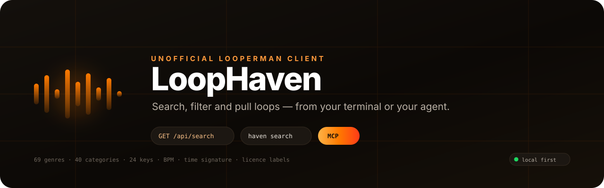

<div align="center">



**A local-first API, CLI and MCP server for Looperman.**

Search loops and acapella previews with real filters, get clean JSON, and pull the
file you picked — from your terminal or from an AI agent.

[](https://pypi.org/project/loophaven/)
[](pyproject.toml)
[](https://github.com/mohamed-amine-ben-mallessa/loop-haven/actions/workflows/ci.yml)
[](src/loophaven/api/app.py)
[](src/loophaven/mcp_server.py)
[](LICENSE)

</div>

> **Unofficial project.** LoopHaven is not affiliated with, endorsed by, or
> supported by Looperman. It reads public pages and your own session, at human
> pace. It does not redistribute audio and does not bypass quotas.
> Read [DISCLAIMER.md](DISCLAIMER.md) before using it.

---

## Why this exists

Looperman hosts a huge community sample library and has no public API. Every
"scraper" out there stops at "here is some HTML". LoopHaven does three things
differently:

1. **It speaks the site's own filter vocabulary.** Genre, category, key, time
   signature, tempo range, date window, sort order — resolved from the real
   advanced-search form, not guessed from URL slugs. Ask for `F#m`, `Bb` or
   `4/4` and it maps them to what the site actually submits.
2. **It is honest about what it returns.** `total` is `null` past page 1,
   because Looperman stops counting. When the quota is hit you get a `429`, not
   a silent MP3 renamed to `.wav`.
3. **It plugs into a DAW workflow and into agents.** One HTTP API, a `haven`
   CLI, and an optional MCP server so Claude, Cursor or any MCP client can
   search and fetch material on your behalf.

<div align="center">

<a href="https://www.looperman.com"></a>

<strong>Built on top of Looperman</strong>

<sub>Unofficial · not affiliated with or endorsed by Looperman Ltd.<br>
The name and logo are trademarks of their owner, used only to identify the site this tool reads.</sub>

</div>

## Quickstart

```bash
pip install "loophaven[mcp]"

# 1. start the local API
python -m uvicorn loophaven.api.app:app --host 127.0.0.1 --port 8000

# 2. search (public previews need no account)
curl "http://127.0.0.1:8000/api/search?genre=Trap&bpm=140&limit=2"
```

Working on the code instead? `git clone https://github.com/mohamed-amine-ben-mallessa/loop-haven.git`,
then `python -m pip install -e ".[dev,mcp]"` — nothing else changes.

A real response, trimmed:

```json
{
  "success": true,
  "count": 2,
  "looperman_url": "https://www.looperman.com/loops?gid=54&ftempo=140&ttempo=140&order=date&dir=d",
  "resolved": { "genre": { "id": 54, "label": "Trap" } },
  "loops": [
    {
      "id": "436799",
      "title": "Lil Uzi Vert Arp Type Loop",
      "bpm": 140,
      "genre": "Trap",
      "key": "Cm",
      "author": "NiemiroMTS",
      "duration_seconds": 13,
      "mp3_url": "https://www.looperman.com/media/loops/8513679/looperman-l-8513679-0436799-...mp3",
      "url": "https://www.looperman.com/loops/detail/436799/..."
    }
  ]
}
```

Interactive docs are at <http://127.0.0.1:8000/docs>.

## CLI

The CLI talks to the local API, so start the server first.

```bash
# find material
haven search --genre Trap --bpm 140 --key Cm --limit 4
haven search --kind acapellas --genre "Boom Bap" --bpm 86 --mf 1 --json

# check what a download will give you (free: does not spend quota)
curl "http://127.0.0.1:8000/api/download/info/loop/436799"

# log in with your own account, then download (WAV for loops, MP3 for acapellas)
haven login
curl -OJ "http://127.0.0.1:8000/api/download/audio/loop/436799"

# audition a preview, toggle a favourite
haven play --id 436799
haven fav --hash <favorite_hash> --type loop
```

`haven login` prompts locally and never stores your password. The session
cookie is persisted so a server restart does not log you out.

## API

| Method | Route | What it does |
|---|---|---|
| `GET` | `/api/health` | status + whether a session is open |
| `GET` | `/api/filters` | full vocabularies (genres, categories, keys, sorts…) |
| `GET` | `/api/search` | loop search with real filters |
| `GET` | `/api/acapellas/search` | acapella search + licence wording |
| `GET` | `/api/loop/{id}` | one loop, parsed from JSON-LD |
| `GET` | `/api/acapellas/{id}` | one acapella + usage terms |
| `GET` | `/api/download/info/{kind}/{id}` | what you would get, without spending quota |
| `GET` | `/api/download/audio/{kind}/{id}` | the actual file |
| `POST` | `/api/download/zip` | personal ZIP of 2–4 loops |
| `POST` | `/api/auth/login` | open a Looperman session |
| `GET` | `/api/auth/status` | session state (never the email) |
| `POST` | `/api/favorites/toggle` | toggle a favourite (needs login) |
| `GET` | `/api/stream/preview` | stream a public MP3 preview |
| `GET` | `/api/download/proxy` | same-origin proxy for previews |

Full parameter reference: [docs/API.md](docs/API.md) ·
Filter tables: [docs/FILTERS.md](docs/FILTERS.md) ·
How the site's internals were mapped: [docs/REVERSE-ENGINEERING.md](docs/REVERSE-ENGINEERING.md).

### MCP

```json
{
  "mcpServers": {
    "loophaven": {
      "command": "loophaven-mcp",
      "env": { "LOOPHAVEN_API": "http://127.0.0.1:8000" }
    }
  }
}
```

Tools: `search_loops`, `search_acapellas`, `get_acapella_detail`,
`get_preview_url`, `export_loop_zip`, `toggle_favorite`. The agent sees JSON,
never HTML.

There is also a ready-made skill in [`skills/loop-haven/SKILL.md`](skills/loop-haven/SKILL.md)
that teaches an agent the etiquette: preview before download, respect the
licence label, never bulk-scrape.

There is also a ready-made skill in [`skills/loop-haven/SKILL.md`](skills/loop-haven/SKILL.md)
that teaches an agent the etiquette: preview before download, respect the
licence label, never bulk-scrape.

## How the filters work

Looperman's advanced search posts a form; the ids below are the real ones, read
from the form itself.

| Filter | Parameter | Example |
|---|---|---|
| Genre | `genre` → `gid` | `Trap` (54), `Hip Hop` (7), `Phonk` (70) |
| Category | `category` → `cid` | `Piano` (21), `Drum` (1), `Vocal` (6) |
| Key | `key` → `mkey` | `Am`, `F#m` → `fsm`, `Bb` → `am` |
| Tempo | `bpm` or `ftempo`/`ttempo` | `bpm=140` → exact; `ftempo=90&ttempo=110` |
| Time signature | `tsig` | `4/4` → `4x4` |
| Date window | `when` | `1`=24 h, `2`=7 d, `3`=30 d, `4`=60 d |
| Sort | `order` + `dir` | `downloads`/`d`, `date`/`d` |
| Keywords | `keyword` → `keys` | `+funky -techno` |

Labels, ids and slugs are all accepted; unknown values return `422` with
suggestions instead of an empty result page. Call `/api/filters` for the whole
vocabulary — **69 genres, 40 categories, 24 keys**.

## Honest limitations

- **This is a wrapper, not an API.** If Looperman changes its HTML, parsing
  breaks. That is the whole reason the reverse-engineering notes are in the repo.
  Three standalone write-ups cover the parts that cost the most time:
  [the hidden search form](https://gist.github.com/mohamed-amine-ben-mallessa/03c051d6184044f72298466ef1df0c9e),
  [the DOM traps](https://gist.github.com/mohamed-amine-ben-mallessa/d80cf3eeea46178e0206dbfcfb98f6f6)
  and [checking a session honestly](https://gist.github.com/mohamed-amine-ben-mallessa/44aba43ba111189bc5aa0b10ea71baea).
- **`total` is `null` after page 1.** Looperman caps the displayed count at
  5,000 and stops showing it on later pages. LoopHaven reports that instead of
  inventing a number.
- **Downloads need your account and are quota-limited.** One account per person.
  A `429` means wait, not retry harder. Nothing here is designed to evade it.
- **Acapellas have no WAV.** Wherever the site serves MP3, the API says MP3 in
  `Content-Type` and a `.mp3` filename.
- **The browser UI at `/` is a French prototype.** The API, CLI and docs are in
  English; that page has not been translated yet.
- **Local single-user only.** There is no API authentication. Do not expose it
  to the internet as-is.

## Legal

LoopHaven is MIT-licensed **code**. The loops and acapellas it helps you find
are not covered by that licence: they belong to their creators and are offered
under Looperman's terms. Looperman is a trademark of its owner. This project is
independent and unaffiliated.

What the project does, on purpose:

- one query at a time, like a browser, with pauses;
- no bulk harvesting, no mirroring of the catalogue;
- no re-hosting of audio — the repo ships zero `.mp3`/`.wav`;
- quotas and account limits are respected, never worked around.

If you are from Looperman and want something changed, open an issue — it will be
handled quickly. See [DISCLAIMER.md](DISCLAIMER.md).

## Contributing

Bug reports, parser fixtures and doc translations are the most useful things
right now. See [CONTRIBUTING.md](CONTRIBUTING.md) and the
[good first issues](https://github.com/mohamed-amine-ben-mallessa/loop-haven/labels/good%20first%20issue).

```bash
python -m pip install -e ".[dev]"
python -m pytest tests/unit -q
```

## Licence

[MIT](LICENSE) — take it, fork it, ship it. A star keeps the crate warm.
